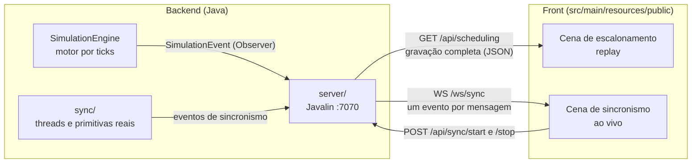
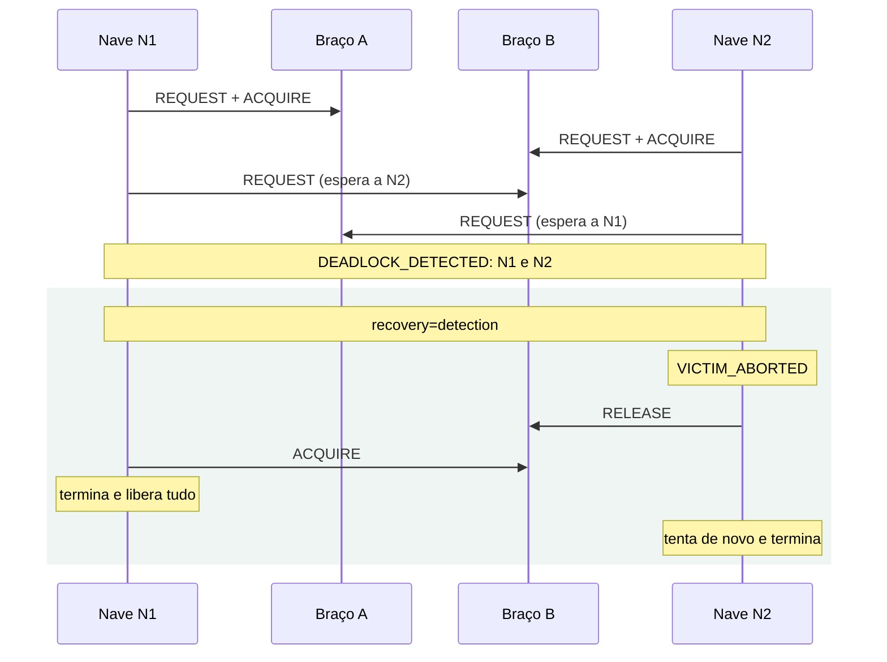

# Promethean — Front end: plano e contrato de eventos

Este documento define **o que o servidor envia e o que o front espera receber**. Ele existe para que o motor, o servidor, o pacote `sync/` e a tela possam ser feitos ao mesmo tempo, por pessoas diferentes, e se encaixem no fim.

> Enquanto o backend não estiver pronto, o front é desenvolvido contra os arquivos de [`public/exemplos/`](../../src/main/resources/public/exemplos/). Eles seguem exatamente o formato descrito aqui.

**Sumário**

1. [Decisões tomadas](#1-decisões-tomadas)
2. [Arquitetura](#2-arquitetura)
3. [Cena de escalonamento (replay)](#3-cena-de-escalonamento-replay)
4. [Cena de sincronismo (ao vivo)](#4-cena-de-sincronismo-ao-vivo)
5. [Arquivos de exemplo e modo demonstração](#5-arquivos-de-exemplo-e-modo-demonstração)
6. [O que o contrato pede de cada parte](#6-o-que-o-contrato-pede-de-cada-parte)
7. [Ordem de entrega e de corte](#7-ordem-de-entrega-e-de-corte)
8. [Pontos em aberto](#8-pontos-em-aberto)

---

## 1. Decisões tomadas

| Tema | Decisão |
|---|---|
| Botão de sincronismo | Desligado mostra a condição de corrida; ligado mostra a proteção e a nave em `BLOCKED` |
| Execução | Escalonamento no motor determinístico por ticks; sincronismo e deadlock em uma cena separada, com threads e primitivas reais |
| Deadlock | Travamento com grafo de espera, detecção com recuperação e timeout com `tryLock` |
| Tecnologia | HTML, CSS e JS puros com SVG, servidos pelo Javalin, sem Node nem build |
| Reprodução | Replay: o servidor roda a simulação inteira e envia o registro; o front tem play, pausa, passo, velocidade e voltar no tempo |
| Visual | Cena espacial estilizada |
| Comparação | Um algoritmo por vez na cena, com tabela de métricas e Gantts empilhados |

---

## 2. Arquitetura

As duas cenas usam canais diferentes porque têm naturezas diferentes. O escalonamento é determinístico e termina em milissegundos, então vai inteiro em uma resposta HTTP. O sincronismo roda em threads reais, então os eventos são enviados por WebSocket conforme acontecem.



| Canal | Direção | Uso |
|---|---|---|
| `GET /` | servidor → front | Página e arquivos estáticos (`src/main/resources/public/`) |
| `GET /api/scheduling/algorithms` | servidor → front | Lista de algoritmos disponíveis |
| `GET /api/scheduling?algorithm=…` | servidor → front | Roda uma simulação e devolve a gravação |
| `POST /api/sync/start?…` | front → servidor | Inicia um cenário de sincronismo |
| `POST /api/sync/stop` | front → servidor | Interrompe o cenário em andamento |
| `WS /ws/sync` | servidor → front | Eventos do cenário, um por mensagem |

Em qualquer erro de parâmetro, o servidor responde `400` com `{"error": "mensagem"}`.

---

## 3. Cena de escalonamento (replay)

### 3.1 Lista de algoritmos

`GET /api/scheduling/algorithms` devolve só os algoritmos que funcionam. O front monta o seletor a partir dessa lista.

```json
[
  {"key": "fcfs", "name": "FCFS"},
  {"key": "sjf", "name": "Shortest Job First"},
  {"key": "priority", "name": "Priority with Aging"}
]
```

`name` é o que `Scheduler.name()` devolve. `key` é o valor usado no parâmetro `algorithm`.

Os três algoritmos previstos são FCFS, SJF e Prioridade. A lista pode começar só com o SJF e crescer: o seletor da tela mostra o que vier, sem mudança no front.

### 3.2 Gravação

`GET /api/scheduling?algorithm=sjf` roda o motor com a carga de referência (`Workload.reference()`) e devolve a gravação:

| Campo | Tipo | Significado |
|---|---|---|
| `version` | número | Versão do contrato. Hoje é `1` |
| `algorithm` | texto | `Scheduler.name()` do algoritmo usado |
| `ports` | lista de texto | Ids das portas, na ordem em que aparecem na tela |
| `spacecrafts` | lista | Naves da carga: `id`, `arrivalTime`, `burstTime`, `basePriority` |
| `events` | lista | Eventos na ordem em que o motor os emitiu (seção 3.3) |
| `metrics` | objeto | O record `SimulationMetrics`, como o Jackson o serializa |

O front ignora campos a mais. Se `spacecrafts` for serializado direto da classe `SpaceCraft`, os outros getters podem ir junto sem problema.

### 3.3 Eventos

Cada evento é o record `SimulationEvent` atual, sem mudança: `tick`, `type`, `spaceCraftId` e `portId`.

| `type` | Quando o motor emite | `portId` | O que o front faz |
|---|---|---|---|
| `ARRIVAL` | A nave chega e entra em `READY` | `null` | Nave entra na órbita de espera |
| `DISPATCH` | A nave é escolhida e atraca | porta | Nave vai da órbita para a porta; abre um trecho no Gantt |
| `PREEMPT` | A nave perde a porta e volta para `READY` | porta | Manobra de recuo; fecha o trecho no Gantt; nave volta para a órbita |
| `FINISH` | A nave termina o burst | porta | Fecha o trecho no Gantt; nave parte da estação |
| `AGING` | Reservado | — | Ignorado nesta versão (seção 8) |

**Regras que o front assume:**

1. A lista `events` está na ordem de emissão. Dentro de um mesmo tick, a ordem é a da seção 5 de [`docs/uml/README.md`](../uml/README.md): chegadas, depois términos e preempções, depois despachos.
2. Um evento no tick `t` vale a partir do instante `t`. Uma nave com `DISPATCH` no tick 8 e `FINISH` no tick 12 ocupou a porta de 8 a 12.
3. Toda nave tem exatamente um `ARRIVAL` e um `FINISH`. Entre eles, cada `DISPATCH` é seguido de um `PREEMPT` ou de um `FINISH` da mesma nave na mesma porta.
4. A simulação termina no tick do último `FINISH`.

### 3.4 O que o front calcula sozinho

O front não recebe o estado da estação a cada tick. Ele o reconstrói aplicando os eventos em ordem, e é isso que permite voltar no tempo: para mostrar o tick 10, basta reaplicar os eventos até o tick 10.

| Informação na tela | Como é obtida |
|---|---|
| Estado de cada nave | Último evento da nave até o tick atual |
| Tempo restante | `burstTime` menos os ticks que a nave já passou atracada |
| Ordem na órbita | Ordem em que as naves entraram em `READY` (`ARRIVAL` ou `PREEMPT`) |
| Gantt | Pares `DISPATCH` → `PREEMPT`/`FINISH` |
| Espera e turnaround por nave | Ticks em `READY` e `FINISH − arrivalTime` |
| Médias e trocas de contexto | Vêm prontas em `metrics` |

### 3.5 Exemplo

Trecho de [`escalonamento-srtf.json`](../../src/main/resources/public/exemplos/escalonamento-srtf.json), que tem uma preempção no tick 1:

```json
{"tick": 0, "type": "ARRIVAL",  "spaceCraftId": "N1", "portId": null},
{"tick": 0, "type": "DISPATCH", "spaceCraftId": "N1", "portId": "P1"},
{"tick": 1, "type": "ARRIVAL",  "spaceCraftId": "N2", "portId": null},
{"tick": 1, "type": "PREEMPT",  "spaceCraftId": "N1", "portId": "P1"},
{"tick": 1, "type": "DISPATCH", "spaceCraftId": "N2", "portId": "P1"}
```

---

## 4. Cena de sincronismo (ao vivo)

Nesta cena cada nave é uma **thread real** que disputa recursos da estação. O servidor emite um evento a cada passo, e o front desenha conforme os eventos chegam.

Nesta entrega os recursos são só os **braços robóticos**: o braço A (`ROBOTIC_ARM_A`) e o braço B (`ROBOTIC_ARM_B`), cada um com capacidade 1. O link de telemetria é um adicional, se sobrar tempo. Como cada cenário declara os seus recursos em `SYNC_START`, incluir o link depois não muda o front.

### 4.1 Iniciar e parar

`POST /api/sync/start?scenario=…&sync=…&recovery=…`

| Parâmetro | Valores | Significado |
|---|---|---|
| `scenario` | `race`, `deadlock` | Qual roteiro executar |
| `sync` | `true`, `false` | O botão de sincronismo: com ou sem primitivas de proteção |
| `recovery` | `none`, `detection`, `timeout` | O que fazer com o deadlock. Só vale para `scenario=deadlock` |

| `scenario` | `sync` | `recovery` | O que deve acontecer |
|---|---|---|---|
| `race` | `false` | — | Várias naves usam o braço A ao mesmo tempo: `COLLISION` |
| `race` | `true` | — | Uma nave por vez no braço A; as outras esperam |
| `deadlock` | `true` | `none` | As naves travam; `DEADLOCK_DETECTED` e fim com `DEADLOCKED` |
| `deadlock` | `true` | `detection` | Uma nave vítima é abortada, solta o recurso e todas terminam |
| `deadlock` | `true` | `timeout` | Uma nave desiste de esperar (`TIMEOUT`), solta o que tem e tenta de novo |
| `deadlock` | `false` | — | Opcional: sem trava não há deadlock, mas há colisão. Pode responder `400` |

Só um cenário roda por vez. `POST /api/sync/stop` interrompe as threads e o servidor emite `SYNC_END` com `reason` igual a `STOPPED`.

### 4.2 Eventos

Cada mensagem do WebSocket `/ws/sync` é um objeto JSON com um evento. Todo evento tem três campos comuns:

| Campo | Tipo | Significado |
|---|---|---|
| `seq` | número | Contador que começa em 0 no `SYNC_START` e cresce de 1 em 1 |
| `timeMs` | número | Milissegundos desde o início do cenário |
| `type` | texto | Tipo do evento (tabela abaixo) |

| `type` | Campos extras | Significado |
|---|---|---|
| `SYNC_START` | `scenario`, `sync`, `recovery`, `spacecrafts` (lista de ids), `resources` (lista de `id` e `capacity`) | Cenário começou. O front monta a cena com essas naves e recursos |
| `REQUEST` | `spaceCraftId`, `resourceId` | A nave pediu o recurso e começou a esperar |
| `ACQUIRE` | `spaceCraftId`, `resourceId` | A nave passou a usar o recurso |
| `RELEASE` | `spaceCraftId`, `resourceId` | A nave soltou o recurso |
| `COLLISION` | `resourceId`, `spaceCraftIds` | Há mais naves no recurso do que a capacidade. Só ocorre com `sync=false` |
| `DEADLOCK_DETECTED` | `spaceCraftIds` | Naves que formam o ciclo de espera |
| `VICTIM_ABORTED` | `spaceCraftId` | A nave foi escolhida como vítima e vai soltar o que segura |
| `TIMEOUT` | `spaceCraftId`, `resourceId` | A nave desistiu de esperar pelo recurso |
| `DONE` | `spaceCraftId` | A nave terminou o trabalho e partiu |
| `SYNC_END` | `reason` (`COMPLETED`, `DEADLOCKED`, `STOPPED`), `collisions`; opcionais `cargoExpected` e `cargoActual` | Cenário terminou |

Campo ausente e campo `null` são equivalentes para o front.

`cargoExpected` e `cargoActual` são uma prova numérica da condição de corrida: cada nave soma unidades de carga em um contador compartilhado enquanto usa o braço. Sem sincronismo, atualizações se perdem e o total real fica abaixo do esperado.

**Regras que o front assume:**

1. Os eventos chegam em ordem de `seq`. Como várias threads emitem, a emissão precisa ser serializada (um método `synchronized` ou uma fila), inclusive com `sync=false`.
2. Todo `ACQUIRE` vem depois de um `REQUEST` da mesma nave para o mesmo recurso.
3. Com `sync=true`, um recurso nunca tem mais naves do que a `capacity`.
4. Os recursos que a vítima ou a nave em `TIMEOUT` soltam aparecem como eventos `RELEASE` normais, logo depois.
5. Os passos visíveis precisam de um intervalo de pelo menos 300 ms entre si (atrasos controlados com `Thread.sleep`), senão a animação não acompanha.

### 4.3 O que o front calcula sozinho

| Informação na tela | Como é obtida |
|---|---|
| Quem usa cada recurso | `ACQUIRE` adiciona, `RELEASE` remove |
| Nave em `BLOCKED` | Entre um `REQUEST` e o `ACQUIRE`, `TIMEOUT` ou `VICTIM_ABORTED` seguinte |
| Grafo de espera | Seta de cada nave bloqueada para o recurso que ela espera, e de cada recurso para quem o segura |
| Ciclo destacado | Naves listadas em `DEADLOCK_DETECTED` |

### 4.4 Roteiro do deadlock



O deadlock precisa de dois recursos de capacidade 1, pedidos em ordem oposta: a N1 pega o braço A e depois quer o B; a N2 pega o B e depois quer o A. Por isso o cenário usa os dois braços, e a corrida (`race`) usa só o braço A.

---

## 5. Arquivos de exemplo e modo demonstração

| Arquivo | Conteúdo | Resultado esperado |
|---|---|---|
| [`escalonamento-fcfs.json`](../../src/main/resources/public/exemplos/escalonamento-fcfs.json) | FCFS na carga de referência | N1 0–8, N2 8–12, N3 12–21, N4 21–26; espera média 8,75 |
| [`escalonamento-sjf.json`](../../src/main/resources/public/exemplos/escalonamento-sjf.json) | SJF não preemptivo na carga de referência | N1 0–8, N2 8–12, N4 12–17, N3 17–26; espera média 7,75 |
| [`escalonamento-srtf.json`](../../src/main/resources/public/exemplos/escalonamento-srtf.json) | SJF preemptivo, com um `PREEMPT` | N1 0–1, N2 1–5, N4 5–10, N1 10–17, N3 17–26; espera média 6,5 |
| [`sincronismo-corrida-desligado.json`](../../src/main/resources/public/exemplos/sincronismo-corrida-desligado.json) | `race` com `sync=false` | 2 colisões; carga 187 de 300 |
| [`sincronismo-corrida-ligado.json`](../../src/main/resources/public/exemplos/sincronismo-corrida-ligado.json) | `race` com `sync=true` | 0 colisões; carga 300 de 300 |
| [`sincronismo-deadlock-travado.json`](../../src/main/resources/public/exemplos/sincronismo-deadlock-travado.json) | `deadlock` com `recovery=none` | Termina em `DEADLOCKED` |
| [`sincronismo-deadlock-recuperado.json`](../../src/main/resources/public/exemplos/sincronismo-deadlock-recuperado.json) | `deadlock` com `recovery=detection` | N2 é a vítima; termina em `COMPLETED` |

Os arquivos ficam em `src/main/resources/public/exemplos/`, junto do front, para o modo demonstração conseguir carregá-los. Os de escalonamento são uma gravação (seção 3.2). Os de sincronismo são a lista das mensagens do WebSocket, na ordem (seção 4.2). Ainda não há exemplo para `recovery=timeout` nem para o algoritmo de Prioridade (seção 8).

Os exemplos de escalonamento foram gerados seguindo a ordem do tick do UML e conferem com as contas à mão do plano de trabalho. Os valores de `timeMs`, colisões e carga dos exemplos de sincronismo são ilustrativos: com threads reais, eles variam a cada execução.

**Modo demonstração.** O front terá uma opção para reproduzir esses arquivos sem servidor. Ela serve para desenvolver a tela antes do backend e como plano B na apresentação.

---

## 6. O que o contrato pede de cada parte

| Parte | O que precisa existir |
|---|---|
| Motor (`simulation/`) | `SimulationEngine` emitindo os quatro eventos na ordem do tick; `DockingPort.getId()`; `MetricsCollector` preenchendo `SimulationMetrics` |
| Servidor (`server/`) | Arquivos estáticos de `public/`; os dois `GET` de escalonamento, que rodam o motor com um listener que guarda os eventos em uma lista; os dois `POST` de sincronismo; o WebSocket `/ws/sync`, que repassa cada evento a todos os clientes conectados |
| Sincronismo (`sync/`) | Os dois roteiros (`race` e `deadlock`) com threads reais; a chave `sync` ligando e desligando as primitivas; detecção do ciclo; emissão dos eventos da seção 4.2 |
| Front (`public/`) | As duas cenas, o replay, o modo demonstração e a derivação de estado das seções 3.4 e 4.3 |

Records e enums do Java já saem no formato certo pelo Jackson, que está no `pom`: `SimulationEvent` e `SimulationMetrics` não precisam de anotação.

---

## 7. Ordem de entrega e de corte

A apresentação pode ser na quarta, 14/10, ou na segunda, 19/10 (mais provável). A ordem abaixo deixa o essencial pronto para a primeira data.

| Meta | Entrega | Se faltar tempo |
|---|---|---|
| Até 13/10 | Cena de escalonamento em replay: chegada, órbita, atracação, término, Gantt, play, pausa, passo, velocidade e tabela de métricas | Essencial |
| Até 13/10 | Cena de sincronismo: botão ligado/desligado (`race`) e deadlock travado com grafo de espera | Essencial |
| Até 16/10 | Detecção e recuperação do deadlock; tema espacial aplicado | Sai o acabamento antes da função |
| Até 18/10 | Gantts empilhados | Primeiro a sair |
| Até 18/10 | Timeout com `tryLock` | Segundo a sair |

Ficam fora desta entrega: várias portas, custo de troca de contexto, animação de aging e carga aleatória.

Se o backend de uma cena não estiver pronto em 14/10, ela é apresentada no modo demonstração.

---

## 8. Pontos em aberto

| Ponto | Situação |
|---|---|
| Evento `AGING` | Está no enum, mas ninguém o emite e o evento não carrega a nova prioridade. O front o ignora até isso ser definido |
| Várias portas | O contrato já suporta (`ports` é uma lista e todo evento tem `portId`), mas a tela desta entrega é desenhada para uma porta |
| Outras cargas | `GET /api/scheduling` usa sempre a carga de referência. Um parâmetro `workload` pode entrar depois sem quebrar o contrato |
| SJF preemptivo | O exemplo `escalonamento-srtf.json` usa o nome `Shortest Remaining Time First`; o nome real virá do `name()` quando a variante existir |
| `contextSwitches` | Hoje é `double` no record e sai como `1.0`. O front aceita os dois formatos |
| Exemplo de Prioridade | O resultado depende de o motor chamar ou não `resetPriority()` no despacho, o que ainda não foi decidido. Na carga de referência as duas opções divergem a partir do tick 12, então não há arquivo de exemplo; o algoritmo aparece na tela quando o servidor o listar |
